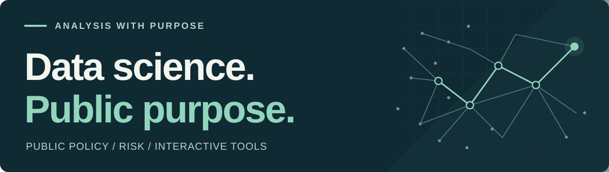

# Philippe Fontaine

**Data scientist & economist · French Senate · Paris, France**

I analyse economic, social and budgetary data to support public policy evaluation and parliamentary oversight. With over ten years of experience in the French public sector, I combine **quantitative analysis, public finance and application development** to turn complex data into useful evidence and tools.

Previously at the General Inspectorate of Finance (IGF), the French Treasury and Insee.

[Portfolio](https://www.philippefontaine.eu) · [LinkedIn](https://www.linkedin.com/in/philippe-fontaine-ds) · [CV in English](https://www.philippefontaine.eu/img/resume/cv_public.pdf) · [CV en français](https://www.philippefontaine.eu/img/resume/cv_public_fr.pdf) · [Email](mailto:philippe.fontaine.ds@proton.me)

## What I work on

- **Policy evaluation and simulation:** econometrics, forecasting and microsimulation applied to taxation, healthcare and public spending. At IGF, I analysed several billion healthcare claims with R and Spark to simulate reforms to coverage for long-term conditions.
- **Fraud detection:** rules engines and web data collection for energy transition and international trade analysis, including a reference database of several million prices.
- **Decision-support tools:** Shiny applications for operational teams and interactive dashboards, including a government revenue dashboard used by the French Budget Directorate for the 2024 spending reviews.

My portfolio also lists my [contributions to public reports](https://www.philippefontaine.eu/index-fr.html#publications).

## Personal applications

These projects are developed in my own time using public data. A selection from my portfolio:

| Application | What it explores | Links |
| :--- | :--- | :--- |
| **Cantines en France** | France's national canteen register, with territorial comparisons and standardised CSV/Parquet datasets. | [App](https://01a0aee7-78d3-4dd3-7139-f8ecce3d410f.share.connect.posit.cloud/) · [data.gouv.fr](https://www.data.gouv.fr/reuses/cantines-en-france-exploration-interactive-et-donnees-normalisees) |
| **Organisation de l'État** | The structure of French ministries and public institutions, using the DILA directory. | [App](https://01a0a64a-ac2e-96e4-1c25-875d47306343.share.connect.posit.cloud/) · [data.gouv.fr](https://www.data.gouv.fr/reuses/organisation-de-letat-organigramme-interactif-des-ministeres-et-institutions) |
| **Obs'COP 2025** | Climate change attitudes across 30 countries, with maps and population profiles. | [App](https://01a1349d-de68-131a-3a1c-bb46ed9e5810.share.connect.posit.cloud/) · [data.gouv.fr](https://www.data.gouv.fr/reuses/obscop-2025-explorer-les-opinions-sur-le-climat) |

[Explore all applications](https://www.philippefontaine.eu/index-fr.html#projects), including integration data, road safety, education and opinion polls.

## Code repositories

- [**ThesisR**](https://github.com/pds023/thesesfr) — R Shiny exploration of doctoral theses defended in France since 1985, by discipline and institution.
- [**CIR**](https://github.com/pds023/minintCIR) — R Shiny analysis of Republican Integration Contract signatories. The [CIR en perspective application](https://01a0ec4a-4a94-aa42-a014-1a44fedf8215.share.connect.posit.cloud/) explores the 2020 cohort.
- [**SignalConso Explorer**](https://github.com/pds023/shinysignalconso) — R Shiny exploration of consumer reports, with synthetic data included for local demonstrations.

## Tools and methods

| Area | Tools & methods |
| :--- | :--- |
| Data processing | **R** (data.table), **Python** (pandas, scikit-learn), **SQL**, **Spark** |
| Analysis | Econometrics, microsimulation, time series, predictive modelling |
| Applications & reporting | **Shiny**, Quarto, HTML, CSS, JavaScript |
| Development & deployment | Git, Docker, GitLab CI/CD |

Outside these projects, I explore cybersecurity and OSINT, social psychology and electronic music production.

[Get in touch](mailto:philippe.fontaine.ds@proton.me) to discuss public data, policy analysis or an application.
